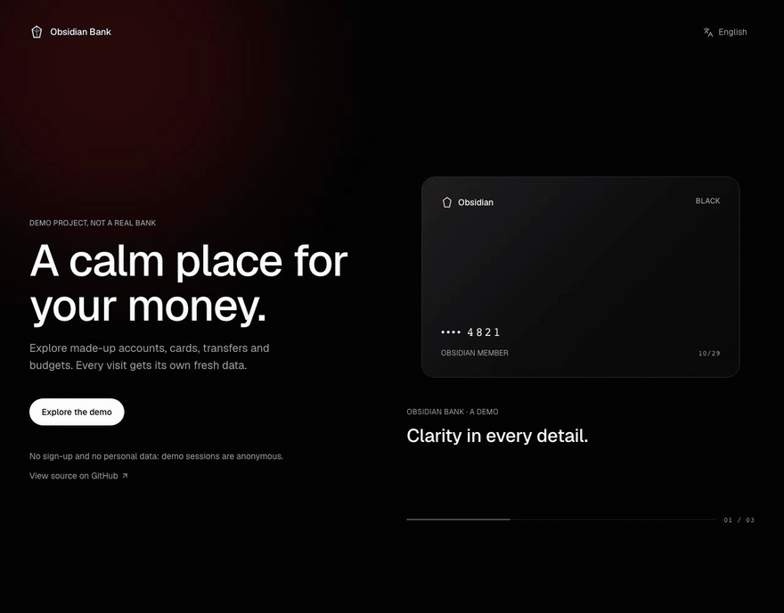
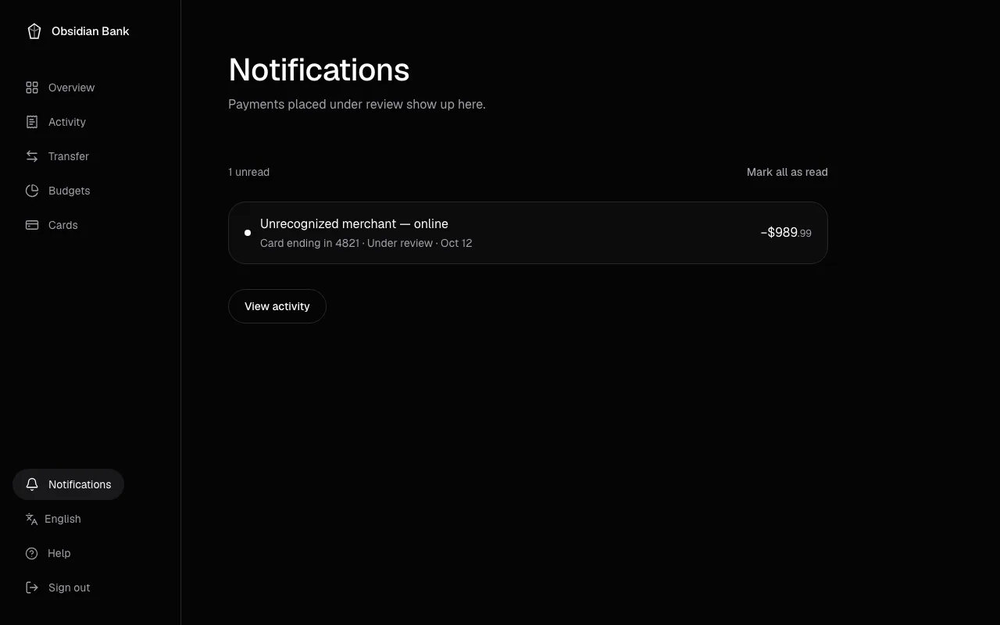
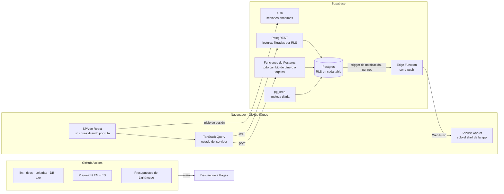

# Obsidian Bank

**Una demo de banca hecha como si fuera real: Row Level Security, reglas del dinero en el servidor, una tarjeta 3D, PWA lista para trabajar sin conexión y web push.**

[](https://github.com/zSamir015/obsidian-bank/actions/workflows/ci.yml)
[](https://github.com/zSamir015/obsidian-bank/actions/workflows/pages.yml)
[](#pruebas)
[](#pruebas)
[](LICENSE)

[English](README.md) | **Español**

Obsidian Bank es una app web de banca personal hecha como proyecto de portfolio. No es un banco real: no hay dinero, cuentas ni tarjetas reales, y nunca se conecta a una red de pagos.

Tiene cuentas corriente y de ahorro, saldo disponible y contable, transferencias entre tus propias cuentas, transferencias simuladas a otros bancos de EE. UU., movimientos con filtros y exportación a CSV, presupuestos mensuales, tarjetas que se pueden congelar o cambiar de límite, y notificaciones cuando un pago queda en revisión. Cada visitante recibe una sesión anónima con tres meses de actividad generada, así que la demo funciona sin registrarse.

**[Demo en vivo →](https://zsamir015.github.io/obsidian-bank/)** · [Guía de uso](docs/USER_GUIDE.es.md) ([English](docs/USER_GUIDE.md)) · [Roadmap](ROADMAP.md) · [Política de seguridad](SECURITY.md)



| Resumen                                                                                             | Movimientos                                                                              |
| --------------------------------------------------------------------------------------------------- | ---------------------------------------------------------------------------------------- |
|     |  |
| **Mover dinero**                                                                                    | **Presupuestos**                                                                         |
|  |  |
| **Tarjetas**                                                                                        | **Notificaciones**                                                                       |
|      |               |

<sub>Grabado del build de producción con los datos de demostración de las pruebas end-to-end. La app está en inglés y en español; las capturas son de la versión en inglés.</sub>

## Lo más destacado

- **Las reglas del dinero viven en la base de datos.** Los saldos solo cambian a través de funciones de Postgres que verifican quién llama, bloquean filas y corren en una sola transacción. Row Level Security mantiene a cada visitante dentro de sus propios datos.
- **Rápida en un teléfono de gama media.** Lighthouse CI exige un presupuesto de LCP, CLS, TBT y JavaScript en cada pull request (Resumen: unos 2.2 s de LCP en el perfil móvil simulado de CI).
- **Una tarjeta 3D que nunca frena la primera carga.** three.js va en un chunk aparte, solo se carga en `/cards` cuando hay WebGL y movimiento completo, y si no, se muestra una tarjeta estática.
- **Instalable y bilingüe.** PWA con pantalla sin conexión (no se guarda ningún dato de la cuenta), web push opcional para pagos en revisión, y toda la interfaz en inglés y en español.
- **Probada de punta a punta en los dos idiomas.** Pruebas unitarias, de base de datos (PGlite), Playwright y axe; los recorridos corren 10 veces seguidas en CI, sin reintentos.

## Stack técnico

[](#cómo-funciona)

React 19 · TypeScript · Vite · Tailwind CSS 4 · TanStack Query · React Hook Form + Zod · React Three Fiber · Supabase (Postgres, Auth, PostgREST, Edge Functions) · Vitest + PGlite · Playwright + axe · Lighthouse CI · GitHub Actions + Pages

## Inicio rápido

```sh
git clone https://github.com/zSamir015/obsidian-bank.git && cd obsidian-bank
npm install
cp .env.example .env   # la URL y la anon key de tu proyecto de Supabase
npm run dev
```

También hace falta aplicar las migraciones a tu proyecto de Supabase; ver [Ejecutarla en local](#ejecutarla-en-local).

## Contenido

- [Lo más destacado](#lo-más-destacado)
- [Inicio rápido](#inicio-rápido)
- [Cómo funciona](#cómo-funciona)
- [Modelo de datos](#modelo-de-datos)
- [Seguridad](#seguridad)
- [Frontend](#frontend)
- [Cómo carga la tarjeta 3D](#cómo-carga-la-tarjeta-3d)
- [Pruebas](#pruebas)
- [CI y despliegue](#ci-y-despliegue)
- [Ejecutarla en local](#ejecutarla-en-local)
- [Estructura del proyecto](#estructura-del-proyecto)
- [Decisiones de diseño y concesiones](#decisiones-de-diseño-y-concesiones)
- [Licencia](#licencia)

## Cómo funciona

El frontend es una app de React de una sola página, servida como archivos estáticos desde GitHub Pages. Todos los datos viven en un proyecto de Supabase (Postgres con Auth y PostgREST delante).



Una visita funciona así:

1. "Explorar la demo" llama al inicio de sesión anónimo de Supabase. Un trigger en el usuario nuevo (`handle_new_user`) ejecuta `seed_demo_data`, que crea una cuenta corriente, una cuenta de ahorro, unas 50 transacciones de tres meses, dos tarjetas y tres presupuestos.
2. Las páginas leen sus datos a través de PostgREST. Row Level Security limita cada consulta a las filas con `user_id = auth.uid()`, así que un usuario solo puede ver sus propios datos.
3. Todo lo que cambia dinero o tarjetas es una llamada a una función de Postgres (`transfer_funds`, `create_external_transfer`, `freeze_card`, `update_card_limit`). Cada una verifica quién llama, valida sus argumentos y hace el cambio completo en una transacción. Cuando termina, TanStack Query invalida las consultas afectadas y todas las pantallas muestran el estado nuevo.
4. Cada vez que se cargan saldos o movimientos, el cliente también llama a `settle_external_transfers`, que marca como completadas las transferencias externas cuyo plazo de dos minutos ya pasó. Corre en paralelo con la lectura, no antes, y si algo se liquidó, se vuelven a pedir saldos y movimientos. Así se simula la liquidación; no hay nada corriendo en segundo plano.
5. Cuando una transacción se crea en revisión (`flagged`) o pasa a ese estado, un trigger (`notify_flagged_transaction`) escribe una notificación para su dueño. La app muestra la cantidad sin leer en una campana y busca notificaciones nuevas cuando la pestaña vuelve a tener el foco y una vez por minuto. Quien lo activa, recibe además un web push (ver [Seguridad](#seguridad)).
6. Un job de `pg_cron` corre todos los días a las 04:17 UTC y borra los usuarios anónimos con más de 7 días sin actividad. Sus cuentas, tarjetas, transacciones y presupuestos se borran con ellos por `ON DELETE CASCADE`.

## Modelo de datos

| Tabla / vista        | Para qué sirve                                                                                               | Quién puede escribir                                                    |
| -------------------- | ------------------------------------------------------------------------------------------------------------ | ----------------------------------------------------------------------- |
| `accounts`           | Cuentas corriente y de ahorro (vault), con un APY en puntos básicos para el ahorro                           | Solo funciones del servidor                                             |
| `transactions`       | Monto positivo en centavos, `type` (`debit`/`credit`), categoría, estado, transferencia y tarjeta opcionales | Solo funciones del servidor                                             |
| `cards`              | Nivel, últimos cuatro dígitos, vencimiento, límite de crédito, gastado y si está congelada                   | Solo funciones del servidor                                             |
| `budgets`            | Límite mensual por categoría de gasto                                                                        | El dueño, con una política de RLS solo para él                          |
| `external_transfers` | Nombre del destinatario, número de ruta, últimos cuatro dígitos de la cuenta, monto y horas de liquidación   | Solo funciones del servidor                                             |
| `notifications`      | Una por transacción puesta en revisión: comercio, monto, últimos cuatro de la tarjeta y hora de lectura      | Solo el trigger; `mark_notifications_read` marca la lectura             |
| `push_subscriptions` | Un navegador que activó el web push: endpoint, claves de cifrado e idioma                                    | El dueño, con `save_push_subscription()` y `delete_push_subscription()` |
| `account_balances`   | Vista con el saldo contable y el disponible de cada cuenta                                                   | Solo lectura; `SELECT` para usuarios con sesión                         |

Algunas reglas valen en todas partes:

- El dinero se guarda como centavos en `bigint` y en TypeScript se maneja con un tipo entero `Cents`. Los montos siempre son positivos y la dirección la da `type`, así que nunca hay que confiar en el signo ni deducirlo.
- El saldo contable es el neto de las transacciones completadas. El disponible es el contable menos los cargos pendientes y en revisión (`flagged`), y es lo que una transferencia puede gastar.
- Las transferencias entre tus propias cuentas usan la categoría `transfer`. No cuentan en los presupuestos ni en entradas y salidas, porque mover dinero entre tus cuentas no es ni lo uno ni lo otro.
- Las transferencias a otro banco usan la categoría `external`. Cuentan como salida de dinero, pero no tienen categoría de presupuesto.
- En las transferencias externas solo llegan al servidor los últimos cuatro dígitos de la cuenta del destinatario. El navegador valida el número completo (de 4 a 17 dígitos) y envía solo `last4`, así que el número completo nunca está en una petición, un log ni la base de datos.
- Una notificación es una copia de tres cosas: comercio, monto y últimos cuatro dígitos de la tarjeta. No tiene datos de la cuenta, del saldo ni otros de la tarjeta, así que se muestre donde se muestre, no puede revelar más que eso.
- Las tarjetas solo guardan los últimos cuatro dígitos. No hay número completo ni CVV en ninguna parte, tampoco en fixtures ni en pruebas.

## Seguridad

Row Level Security está activo en todas las tablas. Los roles de la API (`anon` y `authenticated`) pueden leer sus propias cuentas, transacciones y tarjetas, pero no tienen permiso de `INSERT` ni `UPDATE` sobre ellas, así que la única forma de cambiar un saldo es a través de una función del servidor.

Las funciones del servidor siguen el mismo patrón:

- Son `SECURITY DEFINER` con `search_path` fijado en vacío, para que una función no pueda resolver una tabla u operador de otro esquema.
- Empiezan leyendo `auth.uid()` y no corren sin él. Las auxiliares internas como `seed_demo_data` no las puede ejecutar ningún rol de la API.
- `transfer_funds` bloquea las dos cuentas con `SELECT ... FOR UPDATE` en un orden fijo (por id) y después revisa el saldo disponible. Dos transferencias simultáneas desde la misma cuenta se ejecutan una detrás de la otra, y ninguna puede gastar lo que la otra ya tomó.
- `create_external_transfer` toma un advisory lock por usuario, dentro de la transacción, antes de revisar el límite de $25,000 en 24 horas, así dos pedidos desde cuentas distintas no pueden pasarlo los dos. Después bloquea la cuenta de origen y revisa el disponible. Los números de ruta se validan con las reglas ABA (prefijo asignado y dígito verificador) en `src/lib/aba.ts` y otra vez en la base de datos.
- Las funciones de tarjetas responden `card_not_found` tanto si la tarjeta no existe como si es de otro usuario, así nunca revelan si un id es válido.
- Web push: un navegador se suscribe solo con un clic y guarda su suscripción con `save_push_subscription()`; la API solo puede leer y borrar las suyas. Cuando se crea una notificación, un trigger encola una petición que lleva únicamente el id de la notificación, autenticada con un secreto compartido que no está en el repositorio. La función lee la notificación y envía comercio, monto y últimos cuatro dígitos (el mismo texto que la notificación de la app) a los navegadores de ese usuario. Su modo de prueba solo acepta el token del propio usuario y solo le envía a él.
- Los errores son códigos cortos (`insufficient_funds`, `limit_below_spent`, etc.). El frontend los traduce en `src/lib/errors.ts` y nunca muestra errores crudos de la base de datos.

En el cliente, cada fila que llega de la base de datos pasa por los mappers de `src/lib/mappers.ts`, que la convierten en un tipo de dominio de solo lectura y fallan ante cualquier cosa inesperada, como un estado desconocido o centavos con decimales.

Para reportar una vulnerabilidad, ver [SECURITY.md](SECURITY.md).

## Frontend

- Cada ruta se carga en diferido, y el JavaScript inicial tiene que quedar por debajo de 180 kB gzip; `npm run check:initial-bundle` hace fallar el build si no. El código que comparten varias rutas (`src/hooks`, `src/lib`, `src/components/ui`) va en un solo chunk `shared`, así una pantalla carga su chunk y uno o dos más en lugar de muchos archivos chicos. En el Resumen, las secciones de abajo empiezan a cargar después de que llegan los saldos, para no competir con el pintado más grande (#57).
- El SDK de Supabase no se usa entero. La app importa `@supabase/postgrest-js` directamente y habla con Supabase Auth a través de `src/lib/auth.ts`, un cliente chico para lo que la demo necesita (inicio de sesión anónimo, refresh, cierre de sesión y sincronización entre pestañas), que guarda la sesión en el mismo formato que `@supabase/auth-js`. Quitar `auth-js` le sacó unos 22 kB gzip al primer JavaScript, algo que el LCP del Resumen necesitaba (#57).
- Los datos del servidor solo viven en TanStack Query. Los formularios usan React Hook Form con esquemas de Zod, y los mismos límites se vuelven a exigir en el servidor.
- La interfaz es oscura y casi monocromática. El rojo marca como mucho un elemento por pantalla, y el ámbar queda para los errores, siempre con un ícono y texto para que el color nunca sea la única señal. Las fuentes (Geist y Geist Mono) se sirven desde el propio sitio.
- Todas las animaciones respetan `prefers-reduced-motion`.
- La app se puede instalar (manifest, íconos y `apple-touch-icon`). El manifest se enlaza y el service worker se registra cuando la página ya cargó y el navegador está libre, así ninguno agrega peticiones antes del pintado más grande. El service worker (`src/pwa/sw.js`, que un plugin de Vite escribe en `dist/sw.js` con la lista de archivos) guarda solo el shell de la app: el HTML, el JavaScript y el CSS iniciales, las fuentes precargadas, el catálogo en español, el manifest y los íconos. Los chunks de cada ruta se guardan la primera vez que cargan. Las navegaciones van primero a la red, así un despliegue se ve en la próxima visita, y se conserva el shell anterior para que una pestaña abierta pueda seguir cargando los chunks que usaba. Las peticiones a Supabase nunca pasan por la caché, así que no se guarda ningún dato de la cuenta para usar sin conexión. Si se abre sin conexión, la app muestra una pantalla que lo explica; si la conexión se cae después, agrega un aviso y deja la pantalla como estaba.
- La interfaz está en inglés y en español. Los textos viven en catálogos de mensajes tipados (`src/i18n/messages/`), sin librería de i18n: el inglés va con la app y los demás idiomas cargan como un chunk aparte antes del primer render. El idioma sigue al navegador hasta que el visitante elige uno, y la elección queda guardada en ese dispositivo. Fechas y números se formatean con `Intl` según el idioma; los montos siempre son en dólares. El español usa el locale `es-US`, así los montos mantienen la forma `$1,234.56` que aceptan los campos. El CSV exportado queda en inglés porque sus columnas son un formato documentado.

## Cómo carga la tarjeta 3D

La página de tarjetas muestra una tarjeta 3D interactiva, pero three.js nunca entra en el bundle inicial.

1. `/cards` es una ruta diferida como todas. Su chunk tiene la página, los controles y una versión estática de la tarjeta en CSS.
2. Al montarse, `CardVisual` revisa si el navegador tiene WebGL y si el usuario pidió reducir el movimiento. Si falla cualquiera de las dos, queda la tarjeta estática.
3. Si no, `React.lazy` pide el chunk 3D (three.js, React Three Fiber, Drei, @use-gesture y maath). Mientras baja, la tarjeta estática ocupa el mismo lugar, así nada se mueve.
4. Un error boundary vuelve a la tarjeta estática si el chunk no carga, y lo mismo pasa si se pierde el contexto de WebGL. La tarjeta estática muestra el mismo nivel, últimos cuatro dígitos, titular, vencimiento y estado de congelada.

La tarjeta se presenta como un producto en un estudio. Se puede arrastrar para girarla (libre en el eje vertical, con inclinación limitada) y al soltarla queda en la cara más cercana. "Ver reverso" y "Ver frente" hacen lo mismo con el teclado. En reposo flota y se mece despacio, y se detiene a los 30 segundos sin interacción.

El render es barato. El canvas usa `frameloop="demand"`, así solo se dibujan cuadros mientras algo se mueve, y el loop se detiene por completo cuando la tarjeta sale de la pantalla o la pestaña queda oculta. El arrastre se aplica dentro de `useFrame` en lugar de pasar por el estado de React, así mover el puntero no vuelve a renderizar componentes. El device pixel ratio tiene un tope de 2, los reflejos salen de light formers hechos en código y no de archivos HDR, la sombra se calcula una sola vez, y las dos caras son texturas de canvas dibujadas después de cargar las fuentes.

En pantallas táctiles, deslizar en vertical sigue moviendo la página y arrastrar en horizontal gira la tarjeta. Los controles de congelar y de límite son HTML normal fuera del canvas, y el canvas está marcado como decorativo para los lectores de pantalla.

En escritorio, la página de inicio de sesión usa la misma tarjeta en una historia con scroll. El chunk 3D se pide en tiempo libre después del primer pintado, y "Explorar la demo" se puede usar todo el tiempo.

## Pruebas

| Capa                    | Herramientas                   | Qué cubre                                                                                                                                                                                                       |
| ----------------------- | ------------------------------ | --------------------------------------------------------------------------------------------------------------------------------------------------------------------------------------------------------------- |
| Unitarias y componentes | Vitest, Testing Library, jsdom | Parseo y formato de dinero, fechas, mappers, analítica, exportación CSV, hooks de consultas y estados de las páginas (carga, errores, sin resultados). El formato corre los mismos casos en inglés y en español |
| Base de datos           | Vitest, PGlite                 | Todas las migraciones aplicadas en orden, y después aislamiento de RLS entre usuarios, permisos, restricciones y funciones del servidor                                                                         |
| End to end              | Playwright                     | Inicio de sesión, transferencias internas y externas, presupuestos, tarjetas, notificaciones, movimiento reducido, descarga del CSV y selector de idioma, contra el build de producción, en inglés y en español |
| Accesibilidad           | axe-core dentro de Playwright  | Ninguna violación seria o crítica en las pantallas principales a 1280px y 375px                                                                                                                                 |
| Rendimiento             | Lighthouse CI                  | Inicio de sesión, Resumen y Tarjetas en el perfil móvil                                                                                                                                                         |

Las pruebas de base de datos usan [PGlite](https://pglite.dev/), Postgres compilado a WebAssembly que corre en memoria. `supabase/tests/db.ts` crea una versión mínima del esquema `auth` de Supabase, los roles `anon` y `authenticated` y los permisos por defecto de Supabase, y después aplica las migraciones igual que lo haría `supabase db push`. Así se pueden probar políticas, permisos y funciones como un usuario con sesión real, sin Docker ni una base de datos en línea. PGlite no tiene `pg_cron` ni `pg_net`, así que esas migraciones se revisan de forma estática y la función de limpieza se prueba por separado.

Las pruebas end-to-end nunca tocan el backend real. `e2e/support/demoBackend.ts` intercepta cada petición a Supabase y responde desde datos en memoria, y cualquier petición que no espera hace fallar la prueba. En CI los recorridos corren 10 veces seguidas sin reintentos, para detectar pruebas inestables temprano.

Lighthouse CI revisa el presupuesto de rendimiento en cada pull request, contra un preview de producción con un backend simulado y un móvil simulado. Romper cualquiera de estos hace fallar la ejecución, y el resumen del job muestra los números de cada corrida:

| Métrica                  | Presupuesto |
| ------------------------ | ----------- |
| JavaScript transferido   | 180 kB      |
| Largest Contentful Paint | 2.5 s       |
| Cumulative Layout Shift  | 0.1         |
| Total Blocking Time      | 200 ms      |

Las corridas de Inicio de sesión y Tarjetas además confirman que el módulo 3D no se pide.

## CI y despliegue

El workflow `CI` corre en cada pull request y en cada push a `main`, con estos jobs:

- `check`: lint, tipos, pruebas unitarias, de componentes y de base de datos, el build de producción y los escaneos de axe. Es el check obligatorio, así que una violación seria o crítica nueva bloquea el merge.
- `e2e (en)` y `e2e (es)`: los recorridos de Playwright en cada idioma (10 repeticiones).
- `performance`: la revisión del bundle inicial y Lighthouse CI.

`main` está protegida: los cambios llegan por pull request, el historial queda lineal y `check` tiene que pasar sobre una rama al día con `main`. Dependabot revisa las dependencias y las actions.

Hacer merge a `main` dispara `Deploy Pages`. Corre las pruebas, hace el build con la URL y la anon key de producción desde los secretos del repositorio, y copia `index.html` a un archivo por ruta (`scripts/pages-routes.mjs`), porque GitHub Pages no tiene fallback para aplicaciones de una sola página.

El web push (opcional) necesita, una vez por proyecto: un par de claves VAPID, la Edge Function `send-push` desplegada con sus secretos, la URL de la función y el secreto compartido guardados en Vault (los lee la migración 010), y la clave pública como secreto del repositorio `VITE_VAPID_PUBLIC_KEY`. Sin ese secreto, la opción queda oculta. Los pasos exactos están en la versión en inglés de este README.

CI no aplica las migraciones. Solo avanzan (un archivo aplicado nunca se edita), y cada una se revisa con `supabase db push --dry-run` y se aplica a producción a mano, antes de hacer merge del frontend que depende de ella.

## Ejecutarla en local

Necesitas Node 24 (el LTS actual, el mismo que usa CI) y un proyecto de Supabase.

```sh
npm install
cp .env.example .env   # completa VITE_SUPABASE_URL y VITE_SUPABASE_ANON_KEY
npm run dev
```

Aplica las migraciones de `supabase/migrations/` a tu proyecto en orden, por ejemplo con `supabase link` y después `supabase db push`. Los inicios de sesión anónimos tienen que estar activados en la configuración de Auth del proyecto.

| Script                         | Qué hace                                                                                            |
| ------------------------------ | --------------------------------------------------------------------------------------------------- |
| `npm run dev`                  | Inicia el servidor de desarrollo de Vite                                                            |
| `npm run build`                | Revisa tipos y hace el build de producción                                                          |
| `npm run lint`                 | ESLint                                                                                              |
| `npm run typecheck`            | Revisión de tipos del proyecto                                                                      |
| `npm test`                     | Pruebas unitarias, de componentes y de base de datos                                                |
| `npm run test:e2e`             | Recorridos de Playwright y escaneos de axe contra un build de producción con backend simulado       |
| `npm run check:initial-bundle` | Falla si el JavaScript inicial pasa de 180 kB gzip o importa el módulo 3D de forma estática         |
| `npm run lhci`                 | Lighthouse CI contra un preview de producción con backend simulado                                  |
| `npm run format`               | Prettier                                                                                            |
| `npm run notices`              | Regenera `THIRD_PARTY_NOTICES.md`                                                                   |
| `npm run db:types`             | Regenera `src/types/database.ts` desde el proyecto de Supabase enlazado (necesita `supabase login`) |

## Estructura del proyecto

```
src/
  auth/              contexto de sesión y la ruta protegida
  components/        shell de la app, fila de transacción y el kit de UI en ui/
  hooks/             hooks de TanStack Query, un archivo por recurso
  i18n/              catálogos de mensajes, detección de idioma y contexto de idioma
  lib/               dinero, fechas, mappers, analítica, CSV, mensajes de error y auth
  pages/             una carpeta por ruta, cada una con sus pruebas
  pwa/               service worker, su registro y la pantalla sin conexión
  router/            tabla de rutas y redirecciones antiguas
  types/             tipos de dominio y tipos generados de la base de datos
  test/              fixtures compartidos y configuración de pruebas
supabase/
  migrations/        migraciones SQL numeradas, solo hacia adelante
  functions/         Edge Function send-push
  tests/             pruebas con PGlite, un archivo por migración
e2e/                 specs de Playwright (en inglés y en español) y el backend simulado
scripts/             revisión del bundle, Lighthouse, rutas de Pages, avisos de licencias, íconos
docs/                guía de uso, capturas y notas de diseño
```

## Decisiones de diseño y concesiones

- **Las escrituras pasan por funciones de Postgres y no por updates desde el cliente.** Así cada invariante (sin sobregiros, sin límites negativos, transferencias siempre balanceadas) vive en un solo lugar que el cliente no puede saltarse. El costo es que las reglas de negocio están en SQL, por eso cada migración tiene pruebas.
- **Los saldos se calculan a partir de las transacciones** en la vista `account_balances`, en lugar de guardarse en una columna que hay que mantener sincronizada. Para una demo con unos cientos de filas por usuario es rápido, y elimina toda una clase de errores de desincronización.
- **Sesiones anónimas en lugar de registro.** Los visitantes prueban la app con un clic, y la limpieza diaria mantiene chica la base de datos. La concesión es que una sesión queda atada a un navegador.
- **Un backend simulado para las pruebas end-to-end.** Las hace rápidas, deterministas y seguras de correr en cada pull request. El comportamiento de la base de datos se cubre aparte con PGlite, así entre las dos cubren el camino completo.
- **La liquidación se simula al leer.** Una transferencia externa es un cargo pendiente con un `settles_at` dos minutos después. Cada vez que se cargan saldos o movimientos, el cliente le pide al servidor liquidar las vencidas en paralelo con la lectura, y vuelve a pedir datos solo si algo se liquidó. No hay job que programar, la página nunca se frena por la llamada extra, y el comportamiento se puede probar entero en PGlite. La concesión es que una transferencia solo se liquida cuando se usa la app, algo aceptable para una demo y que la interfaz explica. Las transacciones pendientes y en revisión del seed nunca se liquidan.
- **Un cliente de auth propio en lugar de `@supabase/auth-js`.** La demo solo necesita sesión anónima, refresh y cierre de sesión; la librería completa pesaba unos 22 kB gzip en la primera carga. El cliente guarda la sesión con la misma clave y forma, así que las sesiones existentes siguen sirviendo.

## Licencia

[MIT](LICENSE) © 2026 Samir Lorenzo. Los paquetes y fuentes de terceros mantienen sus propias licencias; ver [THIRD_PARTY_NOTICES.md](THIRD_PARTY_NOTICES.md), que se regenera con `npm run notices`.
