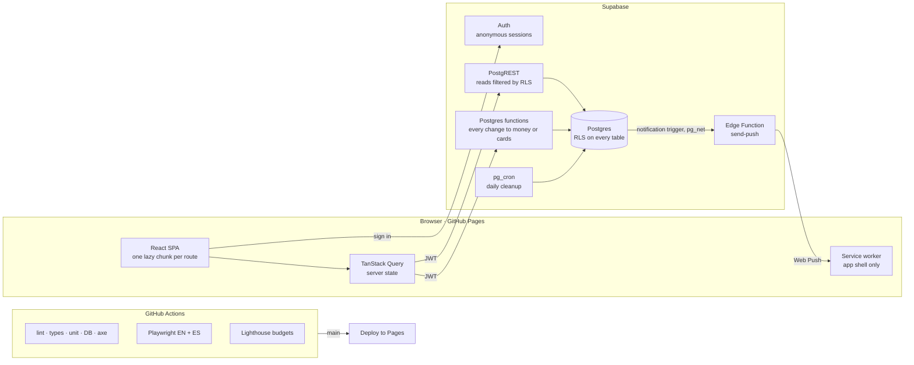

# Obsidian Bank

**A banking demo built like the real thing: Row Level Security, server-side money rules, a 3D card, offline-ready PWA and web push.**

[](https://github.com/zSamir015/obsidian-bank/actions/workflows/ci.yml)
[](https://github.com/zSamir015/obsidian-bank/actions/workflows/pages.yml)
[](#testing)
[](#testing)
[](LICENSE)

**English** | [Español](README.es.md)

Obsidian Bank is a personal banking web app built as a portfolio project. It is not a real bank: no real money, accounts or cards are involved, and it never talks to a payment network.

It has checking and savings accounts, available and ledger balances, transfers between your own accounts, simulated transfers to other US banks, an activity feed with filters and CSV export, monthly budgets, cards that can be frozen or have their limit changed, and notifications when a payment is placed under review. Every visitor gets an anonymous session with three months of generated activity, so the demo works without signing up.

**[Live demo →](https://zsamir015.github.io/obsidian-bank/)** · [User guide](docs/USER_GUIDE.md) ([español](docs/USER_GUIDE.es.md)) · [Roadmap](ROADMAP.md) · [Security policy](SECURITY.md)


| Overview                                                                                         | Activity                                                                                         |
| ------------------------------------------------------------------------------------------------ | ------------------------------------------------------------------------------------------------ |
|  |  |
| **Move money**                                                                                   | **Budgets**                                                                                      |
|             |                |
| **Cards**                                                                                        | **Notifications**                                                                                |
|  |                   |

<sub>Recorded from the production build with the demo data used by the end-to-end tests.</sub>

## Highlights

- **Money rules live in the database.** Balances only change through Postgres functions that check the caller, lock rows and run in one transaction. Row Level Security keeps every visitor inside their own data.
- **Fast on a mid-range phone.** Lighthouse CI enforces an LCP, CLS, TBT and JavaScript budget on every pull request (Overview: about 2.2 s LCP in CI's simulated mobile profile).
- **A 3D card that never slows the first load.** three.js lives in its own chunk, loads only on `/cards` with WebGL and full motion, and falls back to a static card.
- **Installable and bilingual.** PWA with an offline screen (no account data is cached), optional web push for payments under review, and the whole interface in English and Spanish.
- **Tested end to end in both languages.** Unit, database (PGlite), Playwright and axe tests; the journeys run 10 times in a row in CI without retries.

## Tech stack

[](#how-it-works)

React 19 · TypeScript · Vite · Tailwind CSS 4 · TanStack Query · React Hook Form + Zod · React Three Fiber · Supabase (Postgres, Auth, PostgREST, Edge Functions) · Vitest + PGlite · Playwright + axe · Lighthouse CI · GitHub Actions + Pages

## Quickstart

```sh
git clone https://github.com/zSamir015/obsidian-bank.git && cd obsidian-bank
npm install
cp .env.example .env   # your Supabase URL and anon key
npm run dev
```

You also need the migrations applied to your Supabase project; see [Running it locally](#running-it-locally).

## Contents

- [Highlights](#highlights)
- [Quickstart](#quickstart)
- [How it works](#how-it-works)
- [Data model](#data-model)
- [Security](#security)
- [Frontend](#frontend)
- [How the 3D card loads](#how-the-3d-card-loads)
- [Testing](#testing)
- [CI and deployment](#ci-and-deployment)
- [Running it locally](#running-it-locally)
- [Project layout](#project-layout)
- [Design decisions and trade-offs](#design-decisions-and-trade-offs)
- [License](#license)

## How it works

The frontend is a single-page React app served as static files from GitHub Pages. All data lives in a Supabase project (Postgres with Auth and PostgREST in front of it).



A visit goes like this:

1. "Explore the demo" calls Supabase's anonymous sign-in. A database trigger on the new user (`handle_new_user`) runs `seed_demo_data`, which creates a checking account, a savings vault, about 50 transactions over three months, two cards and three budgets.
2. Pages read their data through PostgREST. Row Level Security limits every query to rows where `user_id = auth.uid()`, so a user can only ever see their own data.
3. Anything that changes money or cards is a call to a Postgres function (`transfer_funds`, `create_external_transfer`, `freeze_card`, `update_card_limit`). Each one checks the caller, validates its arguments and does the whole change in one transaction. After it returns, TanStack Query invalidates the affected queries so every screen shows the new state.
4. Whenever balances or activity load, the client also calls `settle_external_transfers`, which marks the caller's external transfers as completed once their two-minute delay has passed. It runs alongside the read rather than before it, and if anything settled, balances and activity are fetched again. This is how settlement is simulated; nothing runs in the background.
5. When a transaction is created as, or moves to, Under review (`flagged`), a trigger (`notify_flagged_transaction`) writes a notification for its owner. The app shows the unread count on a bell and checks for new notifications when the tab regains focus and once a minute. Visitors who opt in also get a web push (see [Security](#security)).
6. A `pg_cron` job runs every day at 04:17 UTC and deletes anonymous users that have been inactive for more than 7 days. Their accounts, cards, transactions and budgets go with them through `ON DELETE CASCADE`.

## Data model

| Table / view         | Purpose                                                                                              | Who can write                                                                  |
| -------------------- | ---------------------------------------------------------------------------------------------------- | ------------------------------------------------------------------------------ |
| `accounts`           | Checking and vault accounts, with an APY in basis points for vaults                                  | Only server functions                                                          |
| `transactions`       | Positive amount in cents, `type` (`debit`/`credit`), category, status, optional transfer id and card | Only server functions                                                          |
| `cards`              | Tier, last four digits, expiry, credit limit, amount spent, frozen flag                              | Only server functions                                                          |
| `budgets`            | Monthly limit per spending category                                                                  | The owner, through an owner-only RLS policy                                    |
| `external_transfers` | Recipient name, routing number, last four digits of the account, amount and settlement times         | Only server functions                                                          |
| `notifications`      | One per transaction placed under review: merchant, amount, card last four, read time                 | Only the trigger; `mark_notifications_read` sets the read time                 |
| `push_subscriptions` | A browser that opted in to web push: endpoint, encryption keys and language                          | The owner, through `save_push_subscription()` and `delete_push_subscription()` |
| `account_balances`   | View with the ledger and available balance of each account                                           | Read-only; `SELECT` granted to signed-in users                                 |

A few rules hold everywhere:

- Money is stored as `bigint` cents and handled in TypeScript as a branded `Cents` integer type. Amounts are always positive and the direction comes from `type`, so the sign never has to be trusted or inferred.
- The ledger balance is the net of completed transactions. The available balance is the ledger minus pending and under-review (`flagged`) debits, which is what a transfer is allowed to spend.
- Transfers between your own accounts use the `transfer` category. They are left out of budgets and out of income and spending totals, since moving money between your own accounts is neither.
- Transfers to another bank use the `external` category. They count as money out, but they have no budget category.
- For external transfers, only the last four digits of the recipient's account number reach the server. The browser validates the full number (4 to 17 digits) and sends `last4` alone, so the full number is never in a request, a log or the database.
- A notification is a copy of three things: merchant, amount and the card's last four digits. It holds no account, balance or other card data, so whatever it is shown in, it can't reveal more than that. The client reads exactly those columns.
- Cards only ever store the last four digits. There is no full card number or CVV anywhere, including fixtures and tests.

## Security

Row Level Security is enabled on every table. The API roles (`anon` and `authenticated`) can read their own accounts, transactions and cards but have no `INSERT` or `UPDATE` grant on them, so the only way to change a balance is through a server function.

The server functions follow the same pattern:

- They are `SECURITY DEFINER` with `search_path` pinned to an empty string, so a function cannot be tricked into resolving a table or operator from another schema.
- They start by reading `auth.uid()` and refuse to run without it. Internal helpers such as `seed_demo_data` are not executable by the API roles at all.
- `transfer_funds` locks both accounts with `SELECT ... FOR UPDATE` in a fixed order (by id), then checks the available balance. Two concurrent transfers from the same account are serialised, and neither can spend money the other has already taken.
- `create_external_transfer` takes a transaction-scoped advisory lock per user before checking the $25,000 rolling 24-hour limit, so two requests from different source accounts cannot both pass it. It then locks the source account and checks the available balance. Routing numbers are validated with the ABA rules (assigned prefix and check digit) both in `src/lib/aba.ts` and in the database.
- Card functions report `card_not_found` both for a card that doesn't exist and for a card owned by someone else, so they never reveal whether an id is valid.
- Web push (migrations 009 and 010, `supabase/functions/send-push`): a browser opts in only from a click, and stores its subscription through `save_push_subscription()`; the API can read and delete its own subscriptions and nothing else. When a notification is created, a trigger queues a `pg_net` request carrying only the notification id, authenticated with a shared secret kept in Vault. The function reads the notification with the service role and sends merchant, amount and last four digits, the same text as the in-app notification, to that user's browsers, and deletes subscriptions the push service reports as gone. Its test mode only accepts a user's own access token and only pushes to that user.
- Errors are short codes (`insufficient_funds`, `limit_below_spent` and so on). The frontend maps them to messages in `src/lib/errors.ts` and never shows raw database errors.

To report a vulnerability, see [SECURITY.md](SECURITY.md).

On the client, every row coming from the database goes through the mappers in `src/lib/mappers.ts`, which turn it into a read-only domain type and throw on anything unexpected, such as an unknown status or a fractional amount of cents.

## Frontend

- Every route is lazy-loaded, and the initial JavaScript must stay under 180 kB gzip. `npm run check:initial-bundle` fails the build otherwise. Code shared by several routes (`src/hooks`, `src/lib`, `src/components/ui`) goes into one `shared` chunk, so a screen loads its own chunk plus at most a couple of others instead of a handful of small files. On Overview, the sections below the balances start loading only after the balances arrive, so they don't compete with the largest paint (#57).
- The Supabase SDK is not used as a whole. The app imports `@supabase/postgrest-js` directly, and talks to Supabase Auth through `src/lib/auth.ts`, a small client for what the demo needs (anonymous sign-in, refresh, sign-out, cross-tab sync) that stores sessions in the same format as `@supabase/auth-js`. Dropping `auth-js` took about 22 kB of gzip off the first JavaScript, which Overview's LCP needed (#57).
- Server data is only kept in TanStack Query. Forms use React Hook Form with Zod schemas, and the same limits are enforced again on the server.
- The interface is dark and mostly monochrome. Red marks at most one element per screen, and amber is reserved for errors, always with an icon and text so colour is never the only signal. Fonts (Geist and Geist Mono) are self-hosted.
- Every animation respects `prefers-reduced-motion`.
- The app is installable (web app manifest, icons, `apple-touch-icon`). The manifest is linked and the service worker registered once the page has loaded and the browser is idle, so neither adds requests before the largest paint. The service worker (`src/pwa/sw.js`, written to `dist/sw.js` by a Vite plugin that injects the file list) precaches the app shell only: the HTML, the entry JavaScript and CSS, the preloaded fonts, the Spanish catalogue, the manifest and icons. Route chunks are cached the first time they load. Navigations are network first, so a deploy shows up on the next visit, and the previous shell is kept so an open tab can still load the chunks it used. Supabase requests never go through the cache, so no account data is stored for offline use. Opened without a connection, the app shows an offline screen; losing the connection later adds a notice and keeps the current screen.
- The interface is available in English and Spanish. Copy lives in typed message catalogues (`src/i18n/messages/`), with no i18n library: English ships with the app and other languages load as a separate chunk before the first render. The language follows the browser until the visitor picks one, and the choice is kept on that device. Dates and numbers are formatted with `Intl` for the active language; amounts are always US dollars. Spanish uses the `es-US` locale, so amounts keep the `$1,234.56` shape the amount fields accept. The CSV export stays in English because its columns are a documented format.

## How the 3D card loads

The cards page shows an interactive 3D card, but three.js never reaches the initial bundle.

1. `/cards` is a lazy route like every page. Its chunk holds the page, the controls and a static CSS version of the card.
2. When the page mounts, `CardVisual` checks whether the browser has WebGL and whether the user has asked for reduced motion. If either check fails, the static card stays.
3. Otherwise `React.lazy` requests the 3D chunk (three.js, React Three Fiber, Drei, @use-gesture and maath). The static card is shown while it downloads, in the same space, so nothing moves.
4. An error boundary switches back to the static card if the chunk fails to load, and so does a lost WebGL context. The static card shows the same tier, last four digits, holder, expiry and frozen state.

The card is presented like a product on a studio set. You can drag it to turn it (freely around the vertical axis, with limited tilt), and on release it settles on the nearest face. "Show back" and "Show front" do the same from the keyboard. At rest it floats and swings slowly and stops after about 30 seconds without interaction.

Rendering is kept cheap. The canvas uses `frameloop="demand"`, so frames are only drawn while something moves, and the loop stops completely when the card is off screen or the tab is hidden. Drag input is applied inside `useFrame` rather than through React state, so moving the pointer does not re-render components. Device pixel ratio is capped at 2, reflections come from light formers built in code rather than HDR files, the contact shadow is baked once, and both faces are canvas textures drawn after the web fonts have loaded.

On touch screens a vertical swipe keeps scrolling the page and a horizontal drag turns the card. Freeze and limit controls are regular HTML outside the canvas, and the canvas itself is marked as decorative for screen readers.

On desktop, the sign-in page reuses the same card in a scroll story. The 3D chunk is requested in idle time after the first paint, and "Explore the demo" stays usable the whole time.

## Testing

| Layer              | Tools                          | What it covers                                                                                                                                                                                                                                               |
| ------------------ | ------------------------------ | ------------------------------------------------------------------------------------------------------------------------------------------------------------------------------------------------------------------------------------------------------------ |
| Unit and component | Vitest, Testing Library, jsdom | Money parsing and formatting, dates, mappers, analytics, CSV export, query hooks, and page states such as loading, errors and empty results. Formatting runs the same cases in English and Spanish                                                           |
| Database           | Vitest, PGlite                 | Every migration applied in order, then RLS isolation between users, grants, constraints and server functions                                                                                                                                                 |
| End to end         | Playwright                     | Sign-in, internal and external transfers, budgets, cards, notifications, reduced motion, CSV download and the language picker, run against the production build once in English and once in Spanish. Tests read their copy from the app's message catalogues |
| Accessibility      | axe-core inside Playwright     | No serious or critical violations on the main screens at 1280px and 375px                                                                                                                                                                                    |
| Performance        | Lighthouse CI                  | Login, Overview and Cards in the mobile profile                                                                                                                                                                                                              |

The database tests use [PGlite](https://pglite.dev/), Postgres compiled to WebAssembly and run in memory. `supabase/tests/db.ts` creates a small stub of Supabase's `auth` schema, the `anon` and `authenticated` roles and Supabase's default privileges, then applies the migrations the same way `supabase db push` would. That makes it possible to test policies, grants and functions as a real signed-in user without Docker or a live database. PGlite has no `pg_cron` or `pg_net`, so those migrations are checked statically and the cleanup function is tested on its own.

End-to-end tests never touch the real backend. `e2e/support/demoBackend.ts` intercepts every Supabase request and answers from an in-memory fixture, and any request it doesn't expect fails the test. In CI the journeys run 10 times in a row without retries, to catch flaky tests early.

The performance budget is checked by Lighthouse CI on every pull request, against a production preview with a local mock backend and simulated mobile throttling. Breaking any of these fails the run, and the job summary shows the numbers of every run:

| Metric                   | Budget |
| ------------------------ | ------ |
| JavaScript transferred   | 180 kB |
| Largest Contentful Paint | 2.5 s  |
| Cumulative Layout Shift  | 0.1    |
| Total Blocking Time      | 200 ms |

The Login and Cards runs also confirm that the 3D module is not requested.

## CI and deployment

The `CI` workflow runs on every pull request and every push to `main`, with these jobs:

- `check`: lint, typecheck, unit, component and database tests, a production build and the axe scans. It is the required check, so a new serious or critical violation blocks the merge.
- `e2e (en)` and `e2e (es)`: the Playwright journeys in each language (10 repetitions).
- `performance`: the initial-bundle check and Lighthouse CI.

`main` is protected: changes arrive through pull requests, the history stays linear, and `check` must pass on a branch that is up to date with `main`. Dependabot watches dependencies and actions.

Merging to `main` triggers `Deploy Pages`. It runs the tests, builds with the production Supabase URL and anon key from repository secrets, and copies `index.html` to one file per route (`scripts/pages-routes.mjs`), because GitHub Pages has no single-page-app fallback.

Web push (optional) needs, once per project: a VAPID key pair (`npx web-push generate-vapid-keys`); the Edge Function deployed with `supabase functions deploy send-push --no-verify-jwt` and the secrets `VAPID_PUBLIC_KEY`, `VAPID_PRIVATE_KEY`, `VAPID_SUBJECT` and `PUSH_WEBHOOK_SECRET` (`supabase secrets set`); the function URL and the same webhook secret stored in Vault as `push_function_url` and `push_webhook_secret`, which migration 010 reads; and the public key as the `VITE_VAPID_PUBLIC_KEY` repository secret. Without that secret the option stays hidden.

Database migrations are not applied by CI. They are forward-only (an applied file is never edited), and each one is checked with a `supabase db push --dry-run` and applied to production by hand, before the frontend that depends on it is merged.

## Running it locally

You need Node 24 (the current LTS, which CI also uses) and a Supabase project.

```sh
npm install
cp .env.example .env   # fill in VITE_SUPABASE_URL and VITE_SUPABASE_ANON_KEY
npm run dev
```

Apply the migrations in `supabase/migrations/` to your project in order, for example with `supabase link` followed by `supabase db push`. Anonymous sign-ins must be enabled in the project's Auth settings.

| Script                         | What it does                                                                                 |
| ------------------------------ | -------------------------------------------------------------------------------------------- |
| `npm run dev`                  | Start the Vite dev server                                                                    |
| `npm run build`                | Typecheck and build for production                                                           |
| `npm run lint`                 | ESLint                                                                                       |
| `npm run typecheck`            | TypeScript project build check                                                               |
| `npm test`                     | Unit, component and database tests                                                           |
| `npm run test:e2e`             | Playwright journeys and axe scans against a production build with a mocked backend           |
| `npm run check:initial-bundle` | Fails if the initial JavaScript exceeds 180 kB gzip or statically imports the 3D card module |
| `npm run lhci`                 | Lighthouse CI against a production preview with a local mock backend                         |
| `npm run format`               | Prettier                                                                                     |
| `npm run notices`              | Regenerate `THIRD_PARTY_NOTICES.md`                                                          |
| `npm run db:types`             | Regenerate `src/types/database.ts` from the linked Supabase project (needs `supabase login`) |

## Project layout

```
src/
  auth/              session context and the protected route
  components/        app shell, transaction row and the small UI kit in ui/
  hooks/             TanStack Query hooks, one file per resource
  i18n/              message catalogues, language detection and the language context
  lib/               money, dates, mappers, analytics, CSV export, error messages, auth
  pages/             one folder per route, each with its tests
  pwa/               service worker, its registration and the offline screen
  router/            route table and legacy redirects
  types/             domain types and generated database types
  test/              shared fixtures and test setup
supabase/
  migrations/        forward-only SQL migrations, numbered
  functions/         send-push Edge Function
  tests/             PGlite tests, one file per migration
e2e/                 Playwright specs (run in English and Spanish) and the mocked backend
scripts/             bundle check, Lighthouse helpers, Pages routes, notices, app icons
docs/                user guide, screenshots and design notes
```

## Design decisions and trade-offs

- **Writes go through Postgres functions instead of client-side updates.** It keeps every invariant (no overdrafts, no negative limits, transfers always balanced) in one place that the client cannot bypass. The cost is that business rules live in SQL, which is why every migration has tests.
- **Balances are computed from transactions** in the `account_balances` view, rather than kept in a column that has to stay in sync. For a demo with a few hundred rows per user this is fast, and it removes a whole class of drift bugs.
- **Anonymous sessions instead of sign-up.** Visitors can try the app in one click, and the daily cleanup keeps the database small. The trade-off is that a session is tied to one browser.
- **A mocked backend for end-to-end tests.** It makes them fast, deterministic and safe to run on every pull request. Database behaviour is covered separately by the PGlite tests, so the two together cover the full path.
- **A small auth client instead of `@supabase/auth-js`.** The demo only needs anonymous sign-in, refresh and sign-out, and the full library weighed about 22 kB gzip on first load. The client stores sessions under the same key and shape, so existing sessions keep working.
- **Settlement is simulated on read.** An external transfer is a pending debit with a `settles_at` two minutes ahead. Each time balances or activity load, the client asks the server to settle due transfers in parallel with the read, and refetches only if something settled. There is no job to schedule, the page is never slowed down by the extra call, and the behaviour can be tested entirely in PGlite. The trade-off is that a transfer only settles when the app is used, which is fine for a demo and is stated in the interface. The seeded pending and under-review transactions never settle.

## License

[MIT](LICENSE) © 2026 Samir Lorenzo. Third-party packages and fonts keep their own licenses; see [THIRD_PARTY_NOTICES.md](THIRD_PARTY_NOTICES.md), regenerated with `npm run notices`.
