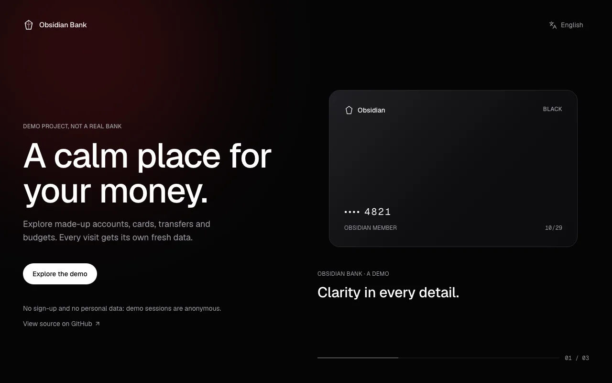
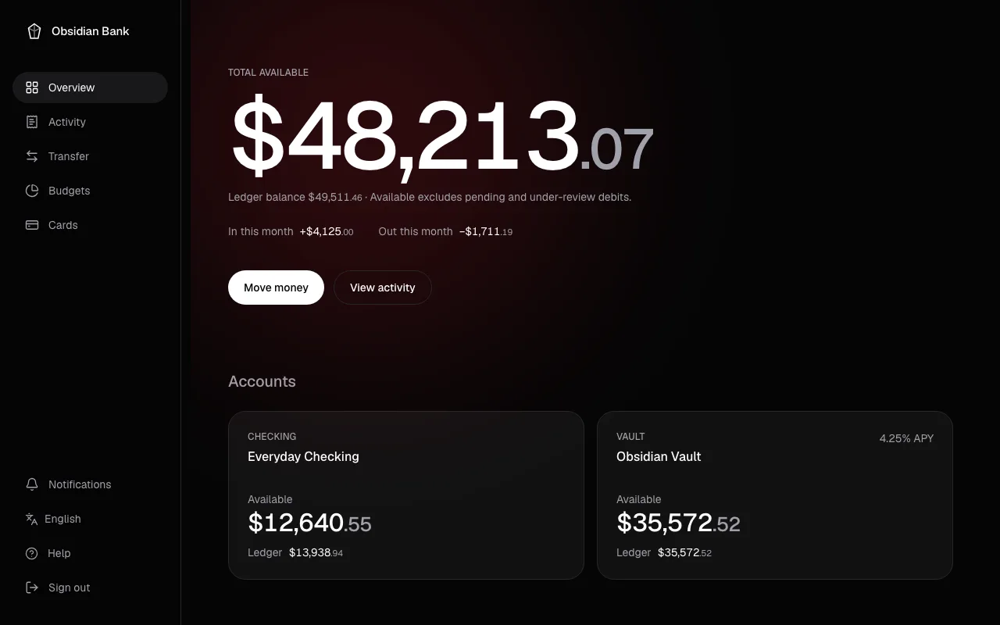
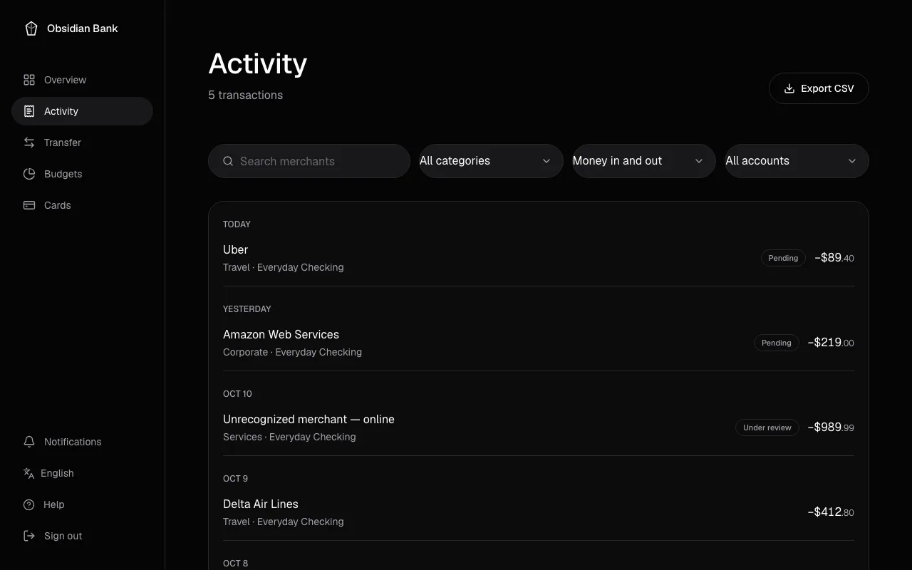
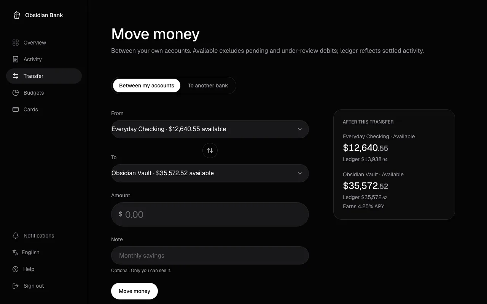
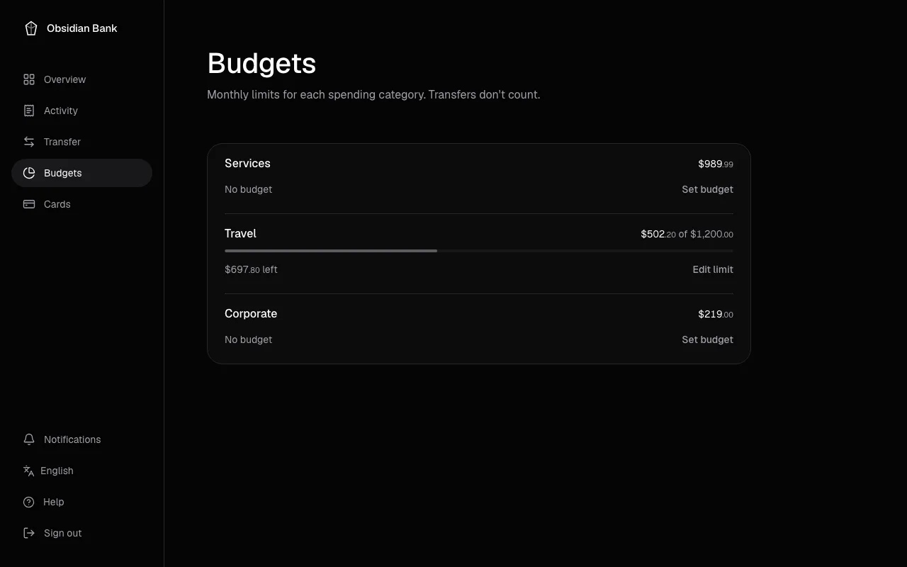
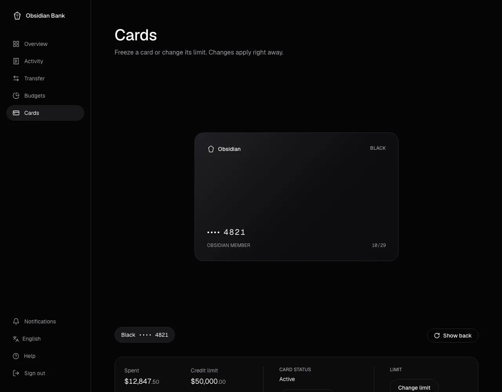
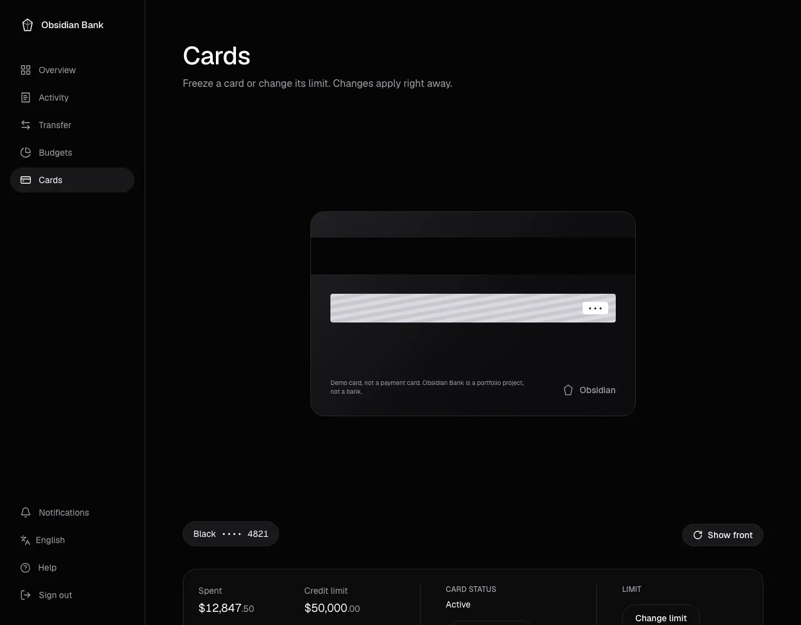

# Guía de uso de Obsidian Bank

Esta guía explica cómo usar la demo de Obsidian Bank, pantalla por pantalla. No necesitas conocimientos técnicos para seguirla. [English version](USER_GUIDE.md).

> **Obsidian Bank es una demo, no un banco real.** No hay dinero, cuentas ni tarjetas reales. Todo lo que ves es inventado.

**Contenido:** [Primeros pasos](#primeros-pasos) · [Resumen](#resumen) · [Movimientos](#movimientos) · [Mover dinero](#mover-dinero) · [Presupuestos](#presupuestos) · [Tarjetas](#tarjetas) · [Notificaciones](#notificaciones) · [Accesibilidad](#accesibilidad) · [Solución de problemas](#solución-de-problemas) · [Glosario](#glosario)

Las capturas de pantalla muestran la app en inglés; en español las pantallas son iguales, con los textos traducidos.

## Primeros pasos

Abre la demo en <https://zsamir015.github.io/obsidian-bank/> y selecciona **Explorar la demo**.

- **Sin registro.** No creas una cuenta ni das datos personales. La demo inicia una sesión anónima y privada solo para ti.
- **Tus propios datos de ejemplo.** Cada sesión nueva empieza con cuentas, tarjetas, movimientos y presupuestos inventados. Lo que haces (transferencias, congelar una tarjeta, nuevos límites) se guarda en tu sesión y nadie más lo ve.
- **Las sesiones se borran tras 7 días sin actividad.** Una vez al día se borran, con todos sus datos, las sesiones que no tuvieron actividad en los últimos 7 días. Si vuelves después, recibes una sesión nueva con datos de ejemplo nuevos.
- **Cerrar sesión** (al final del menú en una computadora, arriba a la derecha en un teléfono) termina tu sesión. Si vuelves a explorar la demo, empieza una nueva.

El menú está a la izquierda en una computadora y en la parte de abajo de la pantalla en un teléfono.

**Idioma.** La demo está en inglés y en español. Empieza en el idioma de tu navegador y puedes cambiarlo con el menú **Idioma** (en la página de inicio de sesión, al final del menú lateral en una computadora o arriba en un teléfono). Tu elección se recuerda en ese dispositivo. Los montos siempre están en dólares estadounidenses.

## Resumen

La primera pantalla después de entrar. Resume tu dinero de un vistazo.

**Qué ves**

- **Total disponible:** el dinero que puedes usar en todas tus cuentas. El **Saldo contable** es el total ya liquidado; el disponible resta los cargos pendientes y en revisión. Debajo, **Entradas este mes** es el dinero que entró desde el día 1 y **Salidas este mes** el que salió. Mover dinero entre tus propias cuentas no cuenta en ninguno de los dos.
- **Mover dinero:** un acceso directo a la pantalla de transferencias.
- **Cuentas:** el saldo disponible y el contable de cada cuenta. La cuenta de **Ahorro** también muestra el interés que genera (por ejemplo _4.25% APY_).
- **Tarjetas:** cada tarjeta por nivel y últimos cuatro dígitos, con una barra que muestra cuánto de su límite está usado. Las tarjetas congeladas dicen **Congelada**. **Administrar** abre la pantalla de Tarjetas.
- **Gastos de este mes:** lo que gastaste en cada categoría, comparado con el presupuesto que fijaste.
- **Movimientos recientes:** tus últimos movimientos. **Ver todos** abre la pantalla de Movimientos.

## Movimientos

Todos los movimientos, del más reciente al más antiguo, agrupados por día (_Hoy_, _Ayer_ y luego fechas).

**Cómo usarla**

1. Escribe en **Buscar comercios** para encontrar un comercio por su nombre, por ejemplo _Uber_.
2. Acota la lista con los filtros:
   - **Entradas y salidas / Entradas / Salidas:** muestra todo, solo el dinero recibido o solo el dinero gastado.
   - **Todas las categorías:** una sola categoría, como _Viajes_.
   - **Todas las cuentas:** una sola cuenta, como la de Ahorro.
3. Los filtros se combinan. Si nada coincide, la pantalla dice _Ningún movimiento coincide con estos filtros_. Cambia o quita un filtro (**Quitar filtros**) para volver a ver resultados.

**Exportar CSV** descarga los movimientos que se ven con los filtros actuales. Las columnas del archivo están en inglés porque siguen un formato fijo.

**Qué significa cada fila**

- Comercio y categoría a la izquierda, monto a la derecha. El dinero que entra lleva **+** y el que sale **−**.
- La etiqueta **Pendiente** significa que el pago todavía no se liquida. **En revisión** significa que se marcó para revisarlo. Ambas se explican en el [glosario](#glosario).

## Mover dinero

Mueve dinero entre tus propias cuentas, por ejemplo de la Corriente a la de Ahorro, o lo envía a una cuenta de otro banco de EE. UU. En el menú se llama **Transferir**. Elige **Entre mis cuentas** o **A otro banco** arriba en la página.

### Entre mis cuentas

**Paso a paso**

1. En **Desde**, elige la cuenta de la que sale el dinero.
2. En **Hacia**, elige la cuenta a la que llega. El botón entre las dos (_Intercambiar cuentas_) invierte Desde y Hacia.
3. Escribe el **Monto** en dólares, con punto para los centavos, como `25.50`.
4. Si quieres, agrega una **Nota** (hasta 140 caracteres). Solo tú puedes verla.
5. Revisa **Después de esta transferencia** a la derecha: muestra el saldo disponible y el contable después de mover el dinero.
6. Selecciona **Mover dinero**. La transferencia llega al instante. Selecciona **Hacer otra transferencia** para empezar de nuevo; los saldos nuevos ya aparecen en tu Resumen.

**Reglas**

- Las dos cuentas deben ser distintas.
- El monto debe ser mayor que $0.00 y no más que el saldo disponible de la cuenta de origen. Los cargos pendientes y en revisión reducen lo disponible aunque no se hayan liquidado. El servidor vuelve a revisar este saldo al procesar la transferencia.
- Una transferencia se completa entera o no se completa: nunca deja el dinero a medio mover.
- Las transferencias entre tus propias cuentas no son ingresos ni gastos. No cuentan en los presupuestos ni en _Entradas este mes_ y _Salidas este mes_.

### A otro banco

Envía dinero a la cuenta de otra persona en un banco de EE. UU., con el número de ruta del banco y el número de cuenta.

Es una demo. Obsidian Bank no se conecta a ACH, Fedwire ni a ninguna otra red de pagos, no se contacta al destinatario ni a su banco, y ningún dinero sale de la app. La página lo dice arriba del formulario.

**Paso a paso**

1. Selecciona **A otro banco**.
2. En **Desde**, elige la cuenta de la que sale el dinero.
3. Escribe el **Nombre del destinatario**.
4. Escribe el **Número de ruta** de 9 dígitos. Está impreso abajo a la izquierda en un cheque, antes del número de cuenta.
5. Escribe el **Número de cuenta** (de 4 a 17 dígitos). Al salir del campo se reemplaza por _Terminada en_ y sus últimos cuatro dígitos; el número completo no se guarda en ningún lado. Selecciona **Cambiar** para escribirlo de nuevo.
6. Escribe el **Monto** y, si quieres, una **Nota**.
7. Selecciona **Enviar transferencia**.

**Qué pasa después**

- La transferencia aparece enseguida en Movimientos como **Pendiente**, con la categoría _Transferencia externa_, el nombre del destinatario y los últimos cuatro dígitos de su cuenta.
- Se descuenta de tu saldo disponible al instante. Tu saldo contable cambia cuando se liquida.
- La liquidación es simulada: unos 2 minutos después de enviarla, la transferencia se marca como completada la próxima vez que se cargan tus saldos o movimientos (por ejemplo al abrir Resumen o Movimientos, o al recargar la página). No ocurre con la app cerrada y nada se ejecuta en segundo plano.

**Reglas**

- El número de ruta debe ser un número de ruta (ABA) válido de EE. UU. La app revisa su prefijo y su dígito verificador, en el navegador y otra vez en el servidor.
- Cada transferencia puede ser de hasta $10,000.00, y las transferencias externas pueden sumar hasta $25,000.00 en 24 horas, contando las pendientes y las liquidadas de todas tus cuentas.
- El monto no puede ser mayor que el saldo disponible de la cuenta de origen.
- El dinero enviado a otro banco cuenta en _Salidas este mes_. No tiene categoría de presupuesto, así que no cuenta contra ningún presupuesto.
- Una transferencia se registra entera o no se registra.

## Presupuestos

Límites de gasto mensuales para cada categoría: Corporativo, Viajes, Servicios y Nómina.

**Cómo usarla**

1. Busca la categoría. Si no tiene límite, dice **Sin presupuesto**.
2. Selecciona **Fijar presupuesto** (o **Editar límite** si ya tiene uno).
3. Escribe el límite mensual en dólares, como `1500`. Debe ser mayor que $0.00.
4. Selecciona **Guardar límite**. La barra y el texto de abajo se actualizan al momento.

**Qué muestra**

- La barra se llena a medida que gastas durante el mes.
- El texto de abajo dice cuánto queda (**restante**) o, cuando el gasto pasa el límite, por cuánto te excediste (**Excedido por**). Pasarse no es un error. La demo no bloquea pagos; el presupuesto está para informarte.
- Solo cuenta el dinero gastado. Las transferencias entre tus propias cuentas nunca cuentan.

## Tarjetas

Muestra cada tarjeta como un modelo 3D que puedes girar, con sus controles debajo.

**Elige una tarjeta:** selecciónala por nivel y últimos cuatro dígitos, por ejemplo **Black •••• 4821**.

**Gira la tarjeta**

- **Con un mouse:** arrastra la tarjeta a la izquierda o a la derecha. Al soltarla queda del lado que más te mira.
- **En un teléfono:** desliza el dedo de lado sobre la tarjeta. Deslizar hacia arriba o hacia abajo mueve la página como siempre.
- **Ver reverso / Ver frente** voltea la tarjeta sin arrastrarla. También funciona con el teclado.
- Si no la tocas, la tarjeta flota y se mece un rato y luego se detiene.

El reverso tiene una banda magnética, un panel de firma y una nota que dice que es una tarjeta de demostración. El código de seguridad solo aparece como `•••`: la demo nunca guarda un número de tarjeta completo ni un código de seguridad.

**Datos de la tarjeta**

- **Gastado:** lo que se ha cargado a la tarjeta.
- **Límite de crédito:** lo máximo que puede gastar la tarjeta.
- **Disponible:** lo que queda por gastar: límite de crédito menos lo gastado.
- **Vence:** mes y año en que vence la tarjeta.

**Congelar o descongelar una tarjeta**

1. Selecciona **Congelar tarjeta**. El estado cambia a _Congelada: se rechazan los pagos nuevos._ y la tarjeta muestra la etiqueta **CONGELADA**.
2. Selecciona **Descongelar tarjeta** para volver a usarla.

**Cambiar el límite**

1. Selecciona **Cambiar límite**.
2. Escribe el **Nuevo límite de crédito** en dólares enteros, como `15000` (sin centavos).
3. Selecciona **Guardar límite**. Un mensaje confirma el nuevo límite.

**Reglas del límite**

- De **$500 a $100,000**, en dólares enteros.
- Nunca por debajo de lo que ya se gastó con la tarjeta. El campo te dice el mínimo real, redondeado al siguiente dólar, por ejemplo _Dólares enteros, de $12,848 a $100,000._

## Notificaciones

Cuando un pago queda **En revisión**, recibes una notificación. La campana (al final del menú lateral en una computadora, arriba en un teléfono) muestra cuántas no has leído.

- Cada notificación dice el monto, el comercio y los últimos cuatro dígitos de la tarjeta usada, por ejemplo _$989.99 en Unrecognized merchant — online con la tarjeta terminada en 4821 está en revisión._ Nunca incluye nada más.
- Las notificaciones nuevas aparecen cuando vuelves a la pestaña, o en menos de un minuto si la tienes abierta.
- **Marcar todo como leído** pone el contador en cero.

Las notificaciones solo aparecen dentro de la demo. Nunca envía correos, mensajes de texto ni notificaciones del navegador.

## Accesibilidad

- **Teclado:** todo funciona sin mouse. Presiona **Tab** para pasar de un control a otro y **Enter** o **Espacio** para usarlos. El primer Tab ofrece **Saltar al contenido**, que salta el menú. En Tarjetas, usa las flechas para cambiar de tarjeta y **Ver reverso / Ver frente** para voltearla.
- **Movimiento reducido:** si tu dispositivo está configurado para reducir el movimiento (un ajuste de accesibilidad en Windows, macOS, iOS y Android), la demo muestra una tarjeta fija, sin flotar, mecerse ni animación de entrada, y voltearla ocurre al instante.
- **Sin 3D:** si tu navegador o dispositivo no puede mostrar gráficos 3D (WebGL), la pantalla de Tarjetas muestra una versión plana de la tarjeta con los mismos datos, frente y reverso. Todos los controles funcionan igual.
- **Lectores de pantalla:** la tarjeta 3D es decorativa. Los datos y el estado de la tarjeta están como texto en los controles de abajo.

## Solución de problemas

**"Esta página no se cargó"**
La app se actualizó mientras la tenías abierta, así que una parte de la pantalla no se pudo descargar (también puede pasar si se cae la conexión). Selecciona **Recargar** para obtener la versión más reciente.

**"Algo salió mal"**
La pantalla tuvo un error inesperado. Selecciona **Volver al resumen** e inténtalo de nuevo.

**"No se pudo cargar tu …" / "No se pudieron cargar tus …"** (saldo, tarjetas, movimientos, presupuestos)
Los datos no llegaron. Selecciona **Reintentar**. Si sigue pasando, revisa tu conexión.

**"No se pudo iniciar la demo"**
No se pudo crear la sesión anónima. Espera unos segundos y vuelve a seleccionar **Explorar la demo**.

**"Tu sesión terminó. Vuelve a entrar para continuar."**
Tu sesión venció o se borró tras 7 días sin actividad. Vuelve a entrar para recibir una sesión nueva con datos de ejemplo nuevos.

**Mis datos cambiaron o desaparecieron**
Las sesiones con más de 7 días sin actividad se borran. Una sesión nueva empieza con datos de ejemplo nuevos.

**La tarjeta 3D no aparece**

- Ver una tarjeta plana en lugar de una 3D es lo esperado cuando el movimiento reducido está activado, o cuando el navegador no puede usar gráficos 3D (WebGL). Consulta [Accesibilidad](#accesibilidad).
- Con una conexión lenta, la tarjeta plana se muestra mientras se descarga la 3D.
- Si los gráficos 3D dejan de funcionar (por ejemplo después de que la computadora sale de suspensión), la tarjeta plana toma su lugar. Recarga la página para volver a intentar el 3D.

**"Esta página no existe" (Error 404)**
La dirección es incorrecta o está desactualizada. Selecciona **Volver al resumen**.

## Glosario

- **APY (rendimiento porcentual anual):** el interés que genera una cuenta en un año, incluido el interés sobre el interés. Aparece en la cuenta de Ahorro, por ejemplo _4.25% APY_.
- **Saldo disponible:** el saldo contable liquidado menos los cargos pendientes y en revisión. Es el monto que puede usar una transferencia entre tus cuentas.
- **Saldo contable:** el total neto de los abonos y cargos completados (liquidados) de una cuenta.
- **Ahorro:** una cuenta de ahorro (Vault). Mueve dinero desde y hacia ella con **Mover dinero**.
- **Número de ruta (ABA):** el número de 9 dígitos que identifica a un banco de EE. UU. Su último dígito es un dígito verificador, así que la mayoría de los errores de escritura se detectan.
- **Liquidación:** cuando un pago pendiente pasa a ser definitivo. En esta demo, las transferencias a otro banco se liquidan unos 2 minutos después de enviarlas, la próxima vez que se cargan tus saldos o movimientos.
- **Pendiente:** un pago que ya se hizo pero todavía no se liquida. Ya aparece en la lista y todavía puede cambiar antes de liquidarse.
- **En revisión:** un movimiento marcado para revisarlo, por ejemplo un pago inusual. En un banco real, alguien lo confirmaría contigo.
- **Disponible (tarjeta):** cuánto puedes gastar todavía: límite de crédito menos lo gastado.
